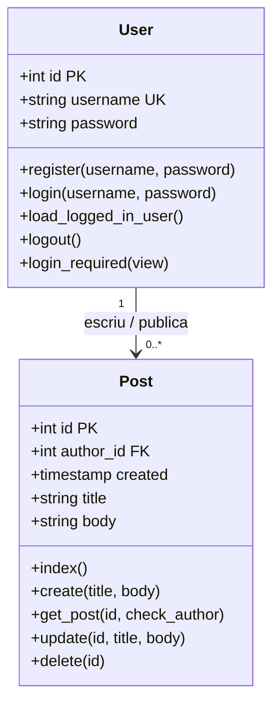

# Diagrama de Classes UML — Aplicació Flaskr

## Objectiu
Aquest document presenta el diagrama de classes UML de l'aplicació web **Flaskr**. L'objectiu és representar visualment l'estructura de dades, els atributs, els mètodes principals i les relacions de cardinalitat entre les entitats del sistema (`User` i `Post`) per facilitar la comprensió i el manteniment del projecte.

